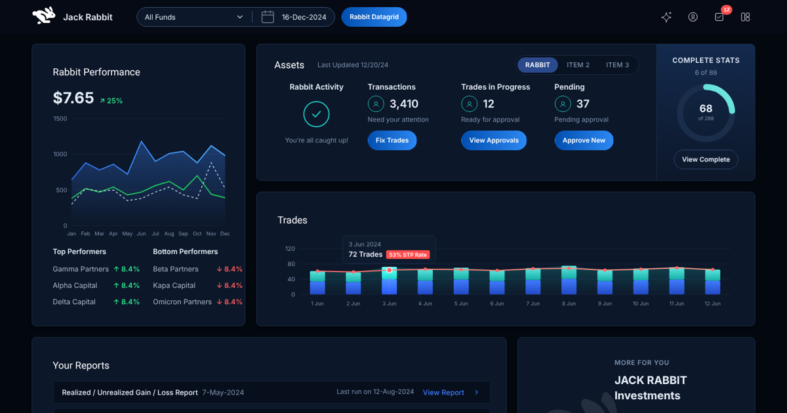

# Jack Rabbit Dashboard (React)



A React dashboard for the Jack Rabbit design challenge. It has a main dashboard and a datagrid page with an infinite, sortable AG Grid. The layout, colours and components follow the supplied design, and the same UI is also built as plain HTML, CSS and JavaScript in a separate repository.

- **Live app:** https://pbarick.github.io/Jackrabbit-react/
- **Plain HTML/JavaScript version:** https://pbarick.github.io/jack-rabbit-dashboard/ ([source](https://github.com/Pbarick/jack-rabbit-dashboard))
- **This repository:** https://github.com/Pbarick/Jackrabbit-react

## What it does

- **Dashboard:** a performance chart, assets with tabs and metrics, a Complete Stats panel, a trades combo chart with hover tooltips, an expandable "Your Reports" list, and a Jack Rabbit Investments panel.
- **Fund filter and date picker** in the header. The fund selection is shared across the app.
- **Rabbit Datagrid:** a summary page with an infinite, sortable AG Grid, stage tabs and filters, a live on/off toggle that updates row statuses, a stepper and a gauge. The button in the header opens it.
- **Responsive layout:** designed for the 1640px form factor, and checked at 360px, 390px, 768px, 1024px and 1440px with no horizontal page scroll. On narrow screens the grid keeps Severity, Fund, Status and Actions and hides the other columns.

## Running it

```bash
npm install
npm run dev         # local dev server
npm run build       # production build into dist/
npm run preview     # serve dist/ at http://localhost:4173/Jackrabbit-react/
npm run lint        # ESLint (flat config in eslint.config.js)
npm run format      # Prettier (format:check to verify only)
npm test            # Vitest + React Testing Library, single run
npm run test:watch  # Vitest in watch mode
```

Requires Node 22 or later for the build.

## How the design was matched

1. **Plain build first.** I built the layout in HTML, CSS and JavaScript, so each card and control could be checked directly in the browser.
2. **Conversion to React.** Each card, chart and control became a component. The styles were moved into named design tokens.
3. **Screenshot comparison.** Both builds were screenshotted at phone, tablet and desktop widths and compared pixel by pixel. Visible differences were fixed. What remains is sub-pixel text anti-aliasing.
4. **Design tokens.** Every colour, font size, spacing value, radius and shadow is a named CSS variable in `src/styles.css`. The theme is controlled in one place.
5. **Consistent components.** Primary and secondary buttons share one shape. Cards share one radius, border and shadow across the dashboard and the datagrid page.

## Architecture

### Routing

`HashRouter` is used because GitHub Pages has no fallback for deep links, so a refresh on `/datagrid` would 404 with `BrowserRouter`. The hash keeps every route on the static host.

| Route       | Page            | Notes                                           |
| ----------- | --------------- | ----------------------------------------------- |
| `/`         | `DashboardPage` | Loaded eagerly                                  |
| `/datagrid` | `SummaryPage`   | `React.lazy`, so AG Grid ships in its own chunk |
| `*`         | `NotFoundPage`  |                                                 |

`AppLayout` owns the header and an `Outlet`. Each route's content sits inside an `ErrorBoundary` keyed by pathname, so a crash on one page resets when the user navigates away. A `Suspense` fallback covers the lazy page.

### Layers

Components follow atomic-design folders, and each layer only imports from the layers below it.

- `components/atoms/`: no app logic. `Button`, `Checkbox`, `IconButton`, `Icons`.
- `components/molecules/`: small stateful pieces. `FundFilter`, `DatePicker`, `LiveSwitch`, `Stepper`, `Metric`, `ReportItem`, and others.
- `components/organisms/`: cards and page sections. `Header`, `PerformanceCard`, `TradesCard`, `SummaryGrid` (AG Grid), and others.
- `components/charts/`: SVG charts written as JSX. There are no HTML strings and no `dangerouslySetInnerHTML`.
- `pages/`: route-level composition.
- `layout/`: the app shell.

### State

- **Fund selection** is shared through `context/FundFilterContext.jsx`, which exposes `useFundFilter()`. It throws if used outside the provider, so a missing provider fails loudly.
- **Live grid rows** live in `data/liveRows.js`, a small store with `getRows`, `subscribeToRows` and `tickLiveRows`. `SummaryGrid` subscribes to it and calls `refreshInfiniteCache` when rows change. It uses a plain subscription rather than React state, so a live tick updates the grid without re-rendering the page.
- Everything else is local component state.

### Data flow

Cards and charts get their data through `services/dashboardService.js`, with hooks in `hooks/useDashboardData.js` wrapping those calls in `useMemo`. The datagrid rows come from the local store in `data/liveRows.js`, not from that service. A few constants (holidays, severity labels, sort ranks) are imported from `data/sampleData.js` directly, since they describe the UI rather than the data.

All data is placeholder. To connect a real API, change `dashboardService.js` so each function calls the API, and replace the grid's local store with a server-backed datasource. Sorting would then move to the server.

### Responsive grid

The summary grid fits its columns to the box and hides lower-priority columns as it narrows:

| Grid width     | Columns shown                          |
| -------------- | -------------------------------------- |
| 760px and up   | all columns                            |
| 680px to 759px | Expected Value and Date Created hidden |
| 520px to 679px | Reason also hidden                     |
| under 520px    | Severity, Fund, Status, Actions        |

Below 560px the grid also uses smaller cell padding and pills (see `styles.css`), so the remaining columns fit without a horizontal scrollbar. The grid refits whenever its width changes.

### Design tokens

Colours, spacing, type sizes, radii, shadows and layout values are CSS custom properties in `src/styles.css`:

1. **Primitive palette**: named colour families with ordinal steps (`--navy-1` is the lightest), using the exact hex values from the design.
2. **Semantic roles**: names such as `--card`, `--text`, `--muted` and `--bar-active`, each pointing at a primitive.
3. **Spacing** (`--space-1` to `--space-8` on the 4px grid), **type** (`--fs-2xs` to `--fs-6xl`), **radius**, **shadows** and **layout** (`--card-pad`, `--content-width`, `--row-h`, `--btn-h`).

Off-grid values from the design keep their exact px in the name (for example `--space-px-14`, `--radius-px-30`, `--fs-2xs`), so every spacing, radius and font value resolves to a token.

### Hooks

- `useElementSize`: `ResizeObserver` size, used by the charts and the grid.
- `useInterval`: runs a callback on an interval using the latest callback ref. A `null` delay pauses it. This drives the live toggle.
- `useOutsideClose`: closes the fund dropdown and date picker on an outside click.

### Analytics

Page views are counted with GoatCounter, which uses no cookies and collects no personal data. The snippet in `public/analytics.js` does nothing until its site code is set, and it can be turned off per browser with a `localStorage` flag.

## Quality

- **Lint and formatting:** ESLint 9 flat config, with `@eslint/js`, `eslint-plugin-react` and `eslint-plugin-react-hooks`. Prettier formats `src`, the README and `index.html`. `src/styles.css` is excluded so its section markers stay intact.
- **Tests:** 22 Vitest tests with React Testing Library, run in jsdom. They cover:
  - `lib/sortRows.js`: sort order, severity ranking, stable ties, no mutation of input.
  - `data/liveRows.js`: subscribe, unsubscribe, tick notification, valid status values.
  - `services/dashboardService.js`: fund selection covers all funds, series lengths match.
  - Components: `FundFilter`, `DatePicker`, `LiveSwitch`, `Stepper`, `ErrorBoundary`.
  - `App`: `/` renders the dashboard, unknown paths render the 404 page.
- **Browser checks:** AG Grid and the SVG charts need a real layout engine, so they are checked by interaction tests and screenshots against the built site, not by unit tests.

## Deploy

GitHub Actions (`.github/workflows/deploy.yml`) runs `npm ci` and `npm run build`, then publishes `dist/` to GitHub Pages on every push to `main`. In repo settings, Pages must use **Source: GitHub Actions**.

The Vite `base` in `vite.config.js` must match the repo name's casing (`/Jackrabbit-react/`), because Pages serves the app from that path.

## Known limitations

- All figures, fund names and report names are placeholder data. The live toggle simulates status changes locally.
- "Learn More" is a placeholder link. "View Report" expands the report but does not open a real file, and "Download CSV" does not export one.
- On phones the datagrid hides columns rather than scrolling sideways, and long fund names are shortened with an ellipsis.
- Fund selection uses React context. A larger app would move it to a store library.
- The summary page's tab row is static.
- The summary page chunk is about 1.26 MB minified, which triggers Vite's chunk-size warning. Splitting AG Grid further is not done.
- Tested in Chrome only, at widths from 360px to 1440px. Widths above 1440px and other browsers have not been tested.

## Structure

```
src/
  App.jsx                  router and route table
  main.jsx                 entry point
  styles.css               design tokens and component styles
  layout/AppLayout.jsx     shell: header, outlet, error boundary
  context/                 shared fund filter state
  pages/                   DashboardPage, SummaryPage, NotFoundPage
  components/
    atoms/ molecules/ organisms/ charts/
    ErrorBoundary.jsx
  services/dashboardService.js   data for the dashboard cards
  data/                    sample data and the live-row store
  hooks/                   useElementSize, useInterval, useOutsideClose, useDashboardData
  lib/                     config, format helpers, sortRows
  test/setup.js            Vitest setup
public/
  analytics.js             optional page-view counting
```
